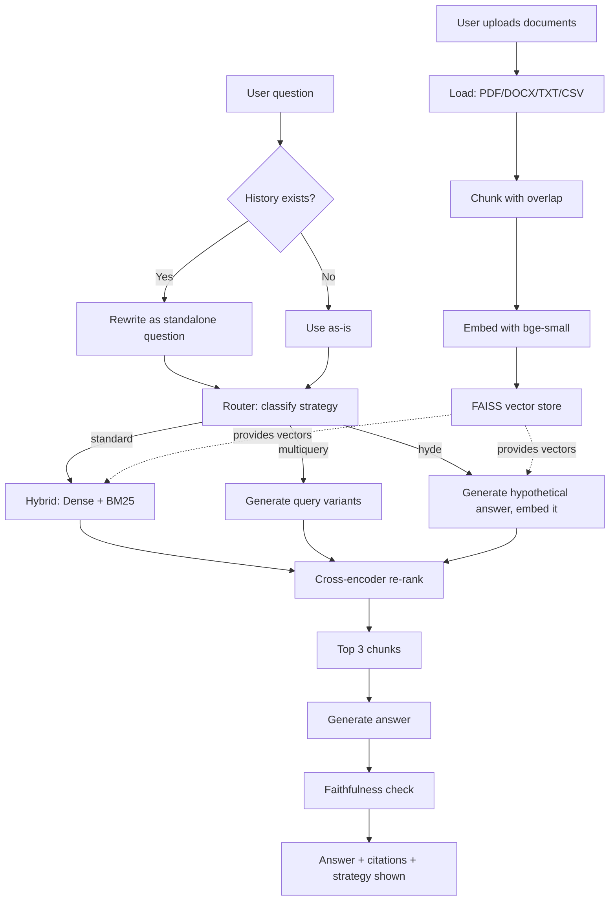

# 📄 Multi-Document RAG Assistant

A retrieval-augmented generation system that lets you upload multiple documents (PDF, DOCX, TXT, CSV) and ask questions across all of them, with cited sources and automatic hallucination detection.

Built to explore production-style RAG engineering: hybrid retrieval, cross-encoder re-ranking, automatic retrieval-strategy routing, and a self-checking faithfulness layer — not just a basic "embed and retrieve" pipeline.

## 🎥 Demos


## Why this projects

Most RAG tutorials stop at "chunk, embed, retrieve, generate." This project goes further:

- **Hybrid retrieval** (dense + BM25), not just vector search
- **Cross-encoder re-ranking** on top of hybrid results
- **Automatic strategy routing** — an LLM classifies each question and picks between standard retrieval, multi-query expansion, or HyDE
- **Conversational query rewriting** for follow-up questions
- **A self-checking faithfulness layer** that flags answers not actually supported by retrieved context
- **A real, labeled evaluation set** — not just "it seemed to work"

## Architecture



## Tech stack

| Layer | Tool |
|---|---|
| Orchestration | LangChain (LCEL) |
| LLM | Groq (`openai/gpt-oss-120b` for generation, `gpt-oss-20b` for routing/rewriting) |
| Embeddings | `BAAI/bge-small-en-v1.5` |
| Vector store | FAISS |
| Sparse retrieval | BM25 |
| Re-ranking | `cross-encoder/ms-marco-MiniLM-L-6-v2` |
| UI | Streamlit |

## Evaluation results

Tested against a 13-chapter ML/AI reference document with a hand-labeled set of 16 questions (13 answerable, 3 deliberately outside the document's scope).

| Metric | Score | What it measures |
|---|---|---|
| Hit Rate@3 | 100% | Did the correct content appear in the top 3 retrieved chunks? |
| Answer correctness | 92% | Did the generated answer contain the expected key facts? |
| Faithfulness rate | 85% | Did the answer avoid adding unsupported claims? |
| Refusal accuracy | 100% | Did the system correctly say "I don't know" on out-of-scope questions? |

Retrieval and generation are evaluated **separately** on purpose — a wrong final answer can come from either stage, and conflating them hides which one actually failed.

## Bugs I found and fixed

Building this surfaced several real issues worth documenting, since finding and understanding them was as valuable as getting the happy path working:

1. **Chroma crashed natively on Windows** (`0xC0000005` access violation, no Python traceback). Root-caused by isolating Chroma from the embedding model in a minimal repro script. Switched to FAISS.
2. **My faithfulness prompt penalized correct-but-incomplete answers.** An answer that omitted a detail from the context (while adding nothing false) was flagged as "unfaithful." Rewrote the prompt to explicitly separate "leaving things out" (fine) from "adding unsupported claims" (not fine).
3. **Silent duplicate indexing.** Re-running ingestion (or re-clicking "Index documents") re-embedded already-indexed files, polluting the vector store with duplicate chunks that skewed retrieval. Fixed with a tracked-files log.
4. **Cross-document leakage.** An unrelated test file (a resume, uploaded during testing) surfaced as the top result for completely unrelated questions, because vector similarity doesn't know about document boundaries. This is a known limitation of a shared single-index design (see Limitations).
5. **Model deprecation.** `llama-3.1-8b-instant` was deprecated by Groq mid-project; had to identify and swap to the current lightweight model (`gpt-oss-20b`) for the router/rewriter roles.

## Limitations

- **Single shared index across all uploaded documents.** A multi-tenant production version would need per-user or per-session index isolation to prevent cross-document leakage.
- **Retrieval-caused hallucination isn't caught.** The faithfulness checker verifies the answer matches retrieved context — but if retrieval itself pulled the wrong context, a "faithful" answer can still be factually wrong. This requires separately strong retrieval metrics (which is why Hit Rate@3 is tracked independently).
- **The automatic strategy router is a single LLM classification call** and can misclassify, particularly on meta-questions about document structure (e.g., "which chapter discusses X") rather than content questions — HyDE in particular struggles here since it generates a hypothetical passage, not a navigational answer.
- **Free-tier rate limits.** Each question costs 3–5 LLM calls (route, rewrite, generate, faithfulness check, plus internal calls for multi-query/HyDE). This is fine for a demo, but wouldn't scale without a paid tier or caching.

## Running locally

```bash
git clone <your-repo-url>
cd rag-assistant
python -m venv venv
venv\Scripts\activate  # Windows
pip install -r requirements.txt
```

Create a `.env` file:P